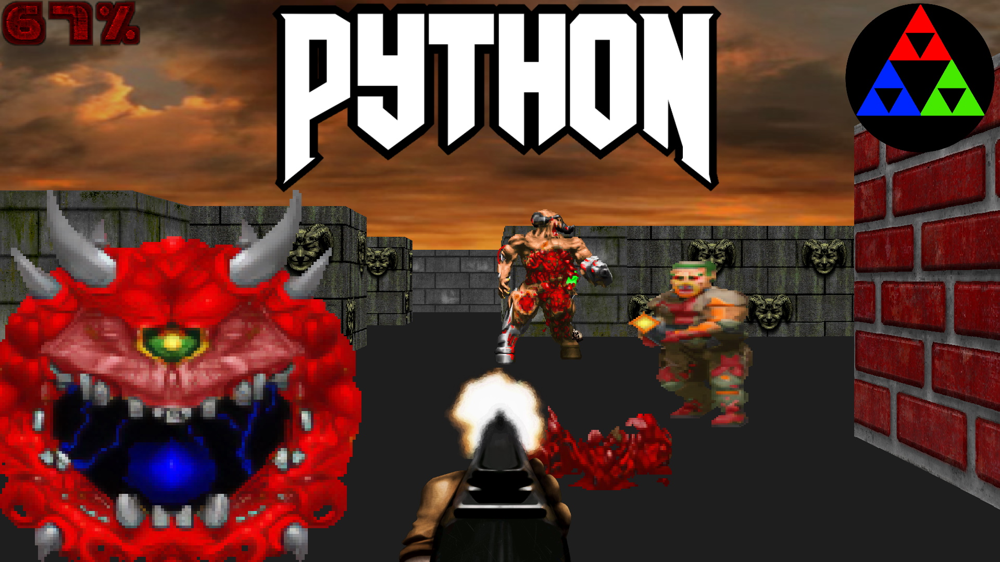

# DOOM-Style Game

DOOM/Wolfenstein-style FPS built in Python with `pygame` and raycasting.



## Project Status

The game already includes:

- movement with `W`, `A`, `S`, `D` and mouse
- raycasting for wall rendering
- animated sprites
- enemies with basic pathfinding
- weapon, damage, HUD, win and lose states

## Requirements

- Python 3.10 or newer recommended
- `pip`
- Dependencies listed in `requirements.txt`

## Installation

```bash
python -m venv .venv
source .venv/bin/activate
pip install -r requirements.txt
```

## Run

Direct entry point:

```bash
python main.py
```

Package entry point:

```bash
python -m game
```

## Controls

- `W`, `A`, `S`, `D`: move
- mouse: aim
- left click: shoot
- `ESC`: quit

## Project Structure

```text
.
├── docs/                  # architecture and development documentation
├── game/                  # main game package
├── resources/             # textures, sprites, and audio
├── main.py                # compatibility entry point
├── requirements.txt
└── README.md
```

### Main Modules

- `game/app.py`: main loop and initialization.
- `game/player.py`: movement, health, and input.
- `game/raycasting.py`: ray casting and wall projection.
- `game/object_renderer.py`: world rendering and HUD.
- `game/object_handler.py`: scene sprites and enemy spawning.
- `game/npc.py`: enemy AI and behavior.
- `game/pathfinding.py`: NPC navigation.
- `game/assets.py`: centralized asset path resolution.

## Additional Documentation

- [Architecture](./docs/architecture.md)
- [Development](./docs/development.md)

## Quick Verification

To validate imports and structure without opening the game window:

```bash
python -m compileall game main.py
```
